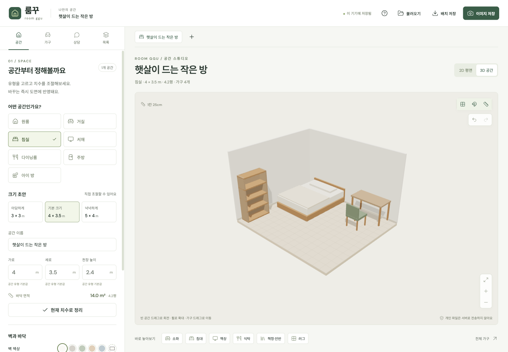
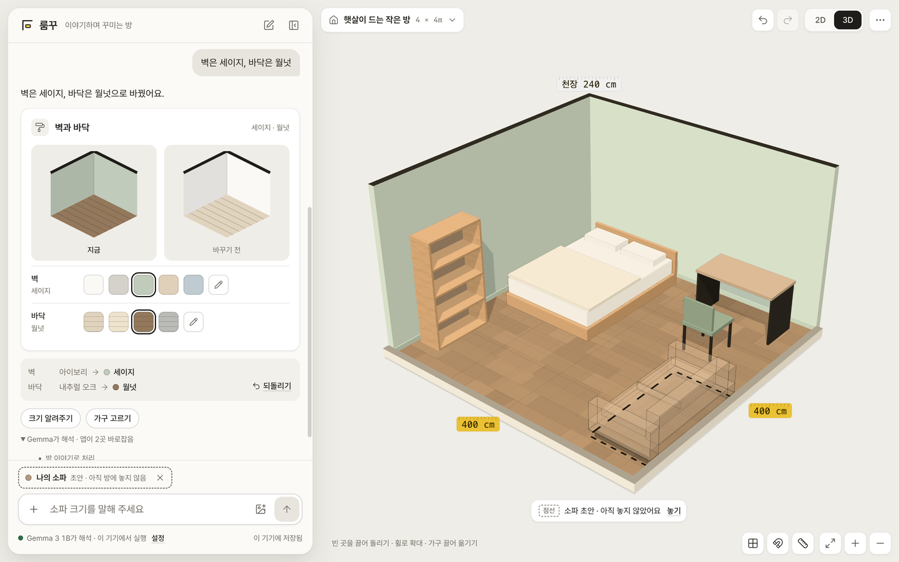
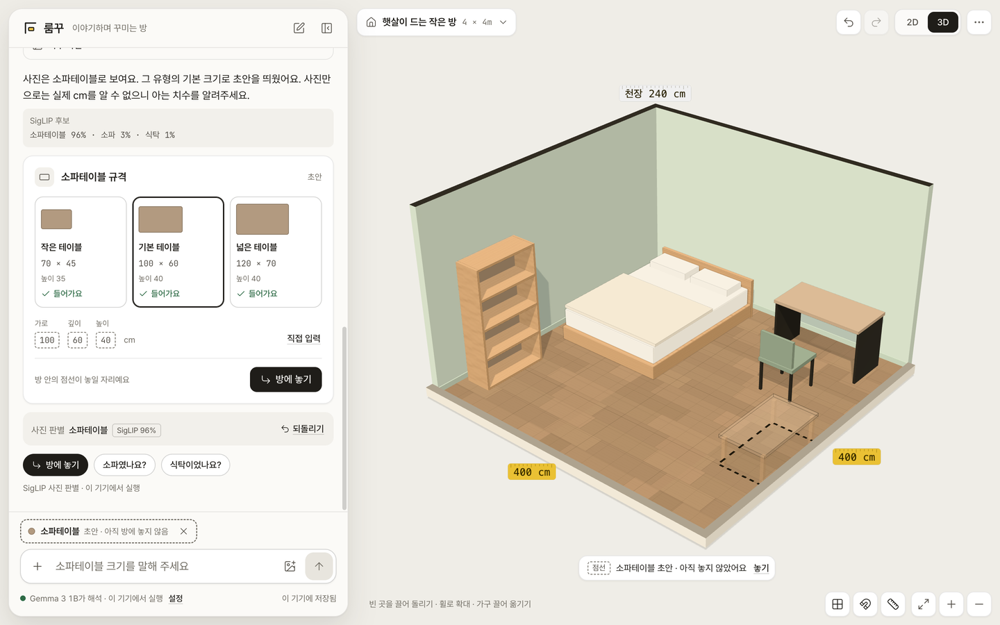
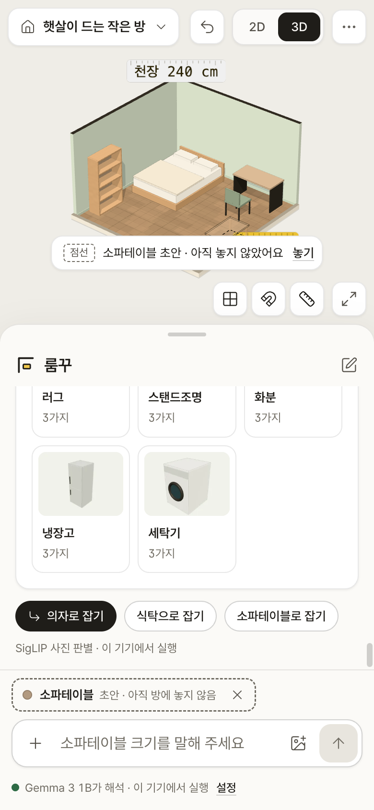
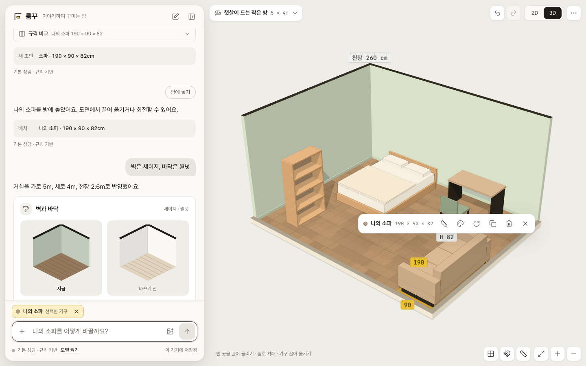
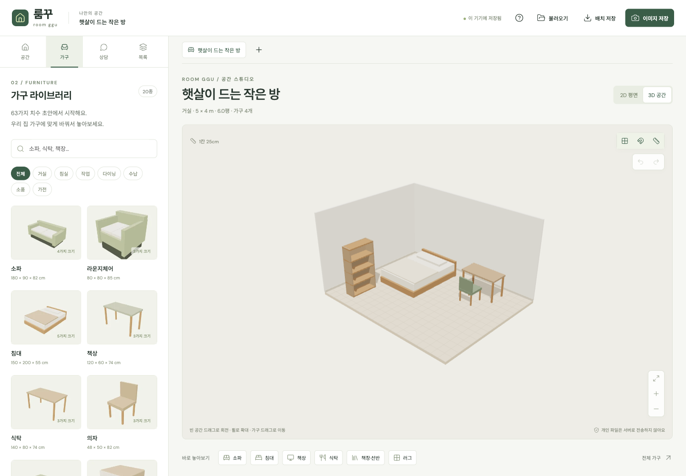
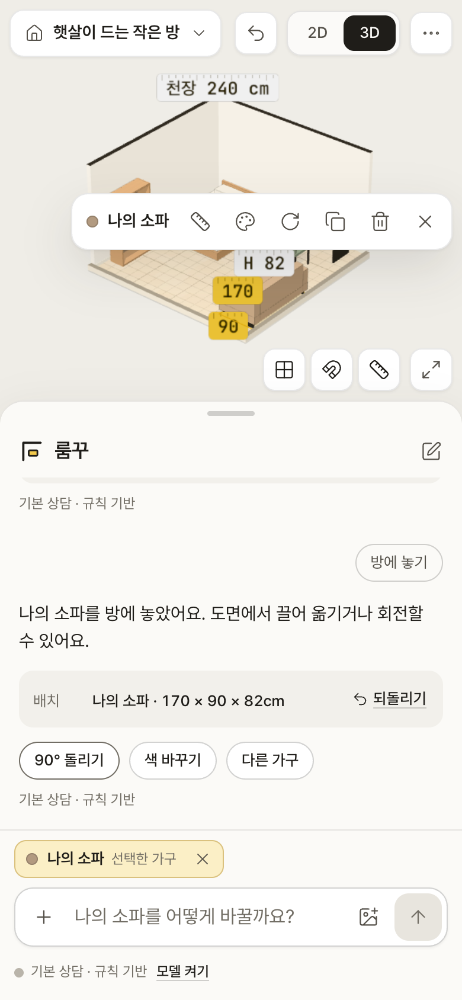

# 룸꾸 · room ggu

**말이나 사진으로 방과 가구를 설명하면 필요한 도구가 대화에 나타나고, 실제 치수의 2D·3D 방에 바로 반영되는 인테리어 웹.**

[사이트 열기](https://jinusong.github.io/room-ggu/) · [기획](docs/product-plan.md) ([HTML](docs/product-plan.html)) · [디자인 방향](docs/design-direction.md) · [검증 기록](docs/verification.md)



| 모델 해석과 앱의 바로잡기 | 사진 판별 | 모바일 사진 후보 |
| --- | --- | --- |
|  |  |  |

| 벽·바닥 비교 | 가구 고르기 | 모바일 |
| --- | --- | --- |
|  |  |  |

## 사용하기

1. 첫 화면의 입력창에 방이나 가구를 말합니다. 상담 모델이 준비되는 동안(처음 한 번 내려받기)에는 규칙으로 먼저 답합니다. “거실 가로 5m 세로 4m”, “두 명이 앉는 소파”, “벽은 세이지, 바닥은 월넛”처럼 쓰면 됩니다. 시작점 버튼(방 크기·가구 고르기·사진·벽과 바닥)으로 시작해도 됩니다.
2. 대화에 맞는 도구가 나타납니다. 방 크기, 공간 유형, 벽과 바닥 비교, 규격 비교, 치수 입력, 가구 색상, 배치 확인 등이 있습니다. 도구를 만지면 방이 바로 바뀌고, 턴마다 바뀐 내용이 영수증처럼 남습니다.
3. 가구를 말하면 점선 초안이 방의 빈자리에 먼저 나타납니다. 벽 쪽을 먼저 찾고 방 안쪽을 보게 둡니다. **방에 놓기**를 누르면 실제로 놓입니다.
4. 놓거나 선택한 가구는 입력창의 대상이 됩니다. “가로 140cm로”, “초록색으로”, “45도 돌려줘”가 그 가구에 적용됩니다. 도면의 도구 막대로 크기·색·회전·복제·삭제를 합니다.
5. 입력창의 `+`에서 모든 도구를 열 수 있습니다. 직접 연 도구도 대화에 남습니다. 공간은 위쪽 공간 버튼에서 바꾸고 최대 12개까지 만듭니다.
6. 파일 메뉴(`…`)에서 배치 JSON 저장·불러오기와 PNG 저장을 합니다. ⌘/Ctrl+Z로 되돌리고, `/`로 입력창에 갑니다.

모바일은 방이 위, 대화가 아래 시트입니다. 손잡이를 누르거나 끌어 낮게·절반·전체로 바꿉니다. 자동 저장은 이 브라우저에만 남습니다. 사진은 저장하지 않고, 대화 글은 이 브라우저에만 저장합니다. 둘 다 배치 파일에는 넣지 않습니다.

## 치수의 출처

치수 옆의 줄자 칩으로 출처를 구분합니다. 노란 줄자는 사용자가 직접 정한 값이고, 점선은 유형 기본값·대화로 가늠한 값·모델 단서·사진 유형 기본값 같은 초안입니다. 사용자가 알려준 숫자는 상담이나 모델이 덮어쓰지 않습니다. 치수는 배치용 초안이므로 구매·설치 전에는 실제로 재야 합니다.

## 로컬 모델과 개인정보

기본은 모델이 해석하고, 규칙은 모델을 쓸 수 없을 때의 대체 경로입니다.

- **상담 모델(기본):** 사이트를 열면 WebGPU가 있는 브라우저에서 `gemma3-1b-it-q4f16_1-MLC`를 WebLLM으로 자동 준비합니다. f16을 지원하지 않는 GPU에서는 `Qwen3-0.6B-q4f32_1-MLC`를 씁니다. 준비되면 모델이 문장마다 의도·동작·가구·공간 유형·크기 느낌·색·다음 도구·답을 JSON으로 정합니다.
- **앱의 검증:** 숫자 치수는 모델이 아니라 문장에서 직접 읽어 그대로 둡니다. 문장에 적힌 가구·공간 이름과 모델 선택이 어긋나면 문장을 따르고, 말하지 않은 속성(벽·바닥·가구 색·공간 유형)과 문장에 없는 동작(삭제·비우기 등)은 실행하지 않습니다. 바로잡은 내용은 답 아래에 “Gemma가 해석 · 앱이 1곳 바로잡음”으로 펼쳐 볼 수 있습니다(`src/app/interpret.js`).
- **규칙(대체):** 모델이 준비 중이거나, 꺼 뒀거나, WebGPU가 없거나, 답이 25초 넘게 늦거나 형식이 틀리면 규칙 계획기(`src/app/planner.js`)가 처리합니다. 답 아래에 “상담 모델 준비 중이라 규칙으로 처리”처럼 이유를 적습니다. 데이터 절약 모드나 메모리 4GB 미만 기기에서는 자동으로 켜지 않고, 입력창 아래에서 켜거나 끌 수 있습니다.
- **사진 판별:** SigLIP base(Transformers.js)가 사진과 20가지 가구 이름을 비교합니다. f16 GPU에서는 4비트 가중치(약 150MB), 아니면 CPU용 8비트(약 210MB)를 씁니다. 확률 70% 이상이면 1순위로 초안을 만들고, 아니면 후보 3개를 버튼으로 보여줍니다. 사진으로 cm를 재지는 않습니다.
- 처음 한 번 공개 저장소에서 모델을 내려받고 브라우저 캐시에 보관될 수 있습니다. 추론은 Web Worker에서 하며 사진과 대화는 추론 서버로 보내지 않습니다.

## 생성형 UI

Google Cloud의 분류로 보면 미리 만든 구성요소 중에서 고르는 정적 방식에 가깝습니다. 앱이 렌더링하는 컴포넌트는 `src/ui-schema.js`의 `SURFACE_KINDS` 14가지입니다. 모델은 다음에 보여줄 도구(방 3가지·가구 3가지)와 동작(가구 고르기·공간 목록·저장 등 열기)을 허용 목록의 문자열로 고르고, 앱이 검증해 `src/ui/surfaces.jsx`의 자체 컴포넌트에 실제 상태를 연결합니다. 모델이 만든 HTML·CSS·JavaScript는 실행하지 않습니다.

문장에 “벽”, “색”, “가로 120cm”처럼 도구를 정하는 단어가 분명한데 모델이 다른 도구를 고르면 앱이 그 단어에 맞는 도구로 바꾸고 바로잡은 내용에 남깁니다. A2UI 프로토콜을 구현하거나 호환을 주장하지 않습니다. 참고 문서는 [디자인 방향](docs/design-direction.md)에 있습니다.

## 구조

| 경로 | 역할 |
| --- | --- |
| `src/catalog.js`, `src/data.js` | 가구·공간 카탈로그, 저장 형식 v3 검증, 경계·충돌 |
| `src/estimator.js`, `src/room-consult.js` | 문장에서 가구·방 치수와 단서 읽기, 모델 크기 단서 적용 |
| `src/app/interpret.js` | 기본 경로: 모델 JSON → 계획, 숫자·이름·말하지 않은 속성 검증 |
| `src/app/planner.js` | 대체 경로: 규칙으로 문장 하나 → 바꿀 내용·도구·다음 칩 |
| `src/app/ops.js` | 검증된 상태 연산, 빈자리 찾기, 변경 내역 |
| `src/app/model-turn.js`, `src/app/photo.js` | 모델 답 문장 거르기, 사진 점수 → 후보 |
| `src/app/store.js` | 대화·초안·선택·실행 취소·저장·모델 상태 |
| `src/ui/` | Preact 화면: 대화 시트, 입력창, 방 위 도구, 생성형 컴포넌트 |
| `src/scene.js`, `src/plan.js`, `src/furniture.js` | 3D 모형, 2D 평면도, 파라메트릭 가구 |
| `src/ai.js`, `src/ai-worker.js` | 브라우저 Worker의 WebLLM(상담)·Transformers.js(사진) |
| `eval/photo/` | 실제 사진 118장 판별 평가(사진 목록·실행·채점·결과) |

## 실행

Node.js 22 이상에서:

```sh
npm ci
npm run dev
npm run verify      # 스킬 연결, 문법, 단위 테스트, 정적 빌드
npm run test:e2e    # Chrome 브라우저 회귀 테스트
npm run format:check
npm run preview
```

실제 모델 평가(WebGPU가 있는 Chrome, `npm run dev`를 띄운 뒤):

```sh
node eval/photo/fetch-images.mjs                  # 평가 사진 118장 내려받기
node eval/photo/run.mjs --device webgpu           # SigLIP 판별 → results/siglip-gpu.json
node eval/photo/score.mjs results/siglip-gpu.json --split test
node eval/chat/run.mjs                            # Gemma에 문장 18개 → results/gemma.json
```

로컬 브라우저 테스트는 설치된 Chrome을, CI는 Playwright Chromium을 씁니다. `dist/`는 서버 없이 배포되는 정적 결과물이며 모델 가중치는 저장소에 넣지 않습니다.

## Codex · Claude Code 공용 파이프라인

이 저장소를 두 도구의 작업 폴더로 열면 `AGENTS.md`와 `CLAUDE.md`가 같은 제품 규칙을 연결합니다.

| 스킬 | 역할 |
| --- | --- |
| `room-ggu-pipeline` | 기획 → 구현 → 디자인 → 문구 → 검증 → 배포 |
| `answer-me-with-html` | 기능 흐름·구조·기획을 한 페이지로 설명 |
| `unslop` | 간격·아이콘·레이아웃·색·타이포그래피·렌더링 검토 |
| `humanizer` | UI·오류·설명 문구를 자연스럽고 구체적으로 수정 |

Codex: `$room-ggu-pipeline`, Claude Code: `/room-ggu-pipeline`. 원본은 `.agents/skills/`, Claude 경로는 `.claude/skills/`의 상대 심볼릭 링크입니다. 정확한 버전은 `skills-lock.json`에 고정했습니다.

기획 페이지 다시 만들기:

```sh
node .agents/skills/answer-me-with-html/scripts/am.mjs render docs/product-plan.md -o docs/product-plan.html --no-open
```

디자인 점검에 쓴 **unslop by Damir Sokolovsky (@heydamir), CC BY 4.0**를 비롯한 출처는 [THIRD_PARTY_NOTICES.md](THIRD_PARTY_NOTICES.md)에 있습니다. 글꼴은 Pretendard(OFL, jsDelivr)와 JetBrains Mono(OFL, @fontsource)입니다.

## 배포

`main`에 푸시하면 GitHub Actions가 검증·브라우저 테스트 후 GitHub Pages에 배포합니다. `base: './'`로 `/room-ggu/` 하위 경로를 지원하고, 배포 버전은 `version.json`의 커밋으로 확인합니다. 비밀키·백엔드·회원가입은 필요하지 않습니다.
