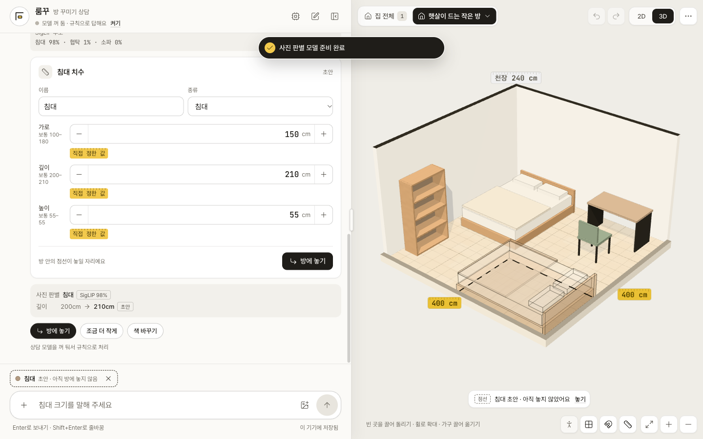

사진 입력부터 판별·설명 반영·직접 수정까지 검토했다. 사진을 빠르게 바꾸거나 작업을 취소해도 최신 선택과 직접 편집한 배치를 지키도록 고쳤다.

[룸꾸 열기](https://jinusong.github.io/room-ggu/)

## A 발견한 문제와 반영한 개선

| 우선순위 | 이전에 생기던 문제 | 이번에 바뀐 동작 |
|---|---|---|
| P0 | 늦게 읽힌 이전 사진이 새 첨부를 덮음 | 마지막 첨부만 반영 |
| P0 | 판별 중 직접 고친 초안이 사라짐 | 배치·초안·대기 목록을 비교해 편집 보호 |
| P0 | 새 대화에 사진 작업이 남음 | 읽기·판별 종료, 늦은 응답 무시 |
| P1 | 다른 종류를 고르면 함께 보낸 설명 누락 | 사진 안에서 40종 검색·선택, 치수·색 보존 |
| P1 | 이전 사진의 후보가 새 사진에 적용됨 | 사진 ID 확인, 새로고침 뒤의 후보도 차단 |
| P1 | 새 사진 초안에 예전 대기 목록이 섞임 | 새 초안 생성 시 이전 대기 목록 비움 |
| P1 | 투명 사진이 검은 배경으로 바뀜 | 흰 배경으로 변환, 원래 비율 유지 |
| P1 | 손상·용량 초과 파일의 복구 안내 부족 | 오류를 입력창에 남기고 사진·작성 중인 글 보존 |
| P1 | 비트맵 API 미지원 시 사진 처리 실패 | Image 대체 경로와 임시 자원 해제 |
| P2 | 사진이 잘리고 작은 후보 버튼이 누르기 어려움 | 전체 이미지 표시, 44px 선택 영역 |

{table filter}

## B 사진 한 장이 초안이 되는 과정

```flow
(첨부·드롭·붙여넣기) -> 파일 준비: 20MB 이하, 최장 변 768px
파일 준비 -> 종류 판별: SigLIP, 자동 20종
종류 판별 -> {상대 점수 70% 이상?}
{상대 점수 70% 이상?} -> 점선 초안: 예, 직접 편집한 상태가 없을 때
{상대 점수 70% 이상?} -> 후보·직접 선택: 아니요, 함께 보낸 설명 보관
후보·직접 선택 -> 점선 초안: 전체 40종에서 고르기
점선 초안 -> 치수·색 반영: 사용자가 쓴 값
치수·색 반영 -> (방에 놓기)
```

사진의 크기는 가구 유형 기본값에서 시작한다. 직접 쓴 cm는 노란 줄자로 표시한다. 후보 %는 20종 사이의 상대 점수다.

## C 실제 앱에서 확인한 장면

실제 침대 사진에 “가로 150cm 깊이 210cm 높이 55cm”를 함께 보냈다. SigLIP이 침대로 판별했고 같은 초안에 세 치수가 반영됐다. 페이지 오류는 없었다.



## D 자동 테스트 범위

| 검증 | 결과 | 확인한 범위 |
|---|---|---|
| 단위 테스트 | 256개 통과 | 전체 계산·상태 검증, 새 사진 단위 테스트 42개 포함 |
| Chrome | 139개 통과 | 전체 회귀, 사진 입력·흐름 50개 포함 |
| Firefox | 45개 통과 | 파일 입력 22개와 판별·취소·후보 선택 흐름 23개 |
| WebKit | 45개 통과 | 같은 사진 입력·판별 흐름 |
| 화면 크기 | 5종 확인 | 1440·1024·900·390·320px, 입력창·가로 넘침·누름 영역 |

PNG·JPEG·WebP, 투명 영역, EXIF 회전, 빈 파일, 손상 파일, 20MB 초과, 형식 오류를 다뤘다. 빠른 교체·취소·새 대화·공간 이동·Worker 실패·재시도·낮은 확신·잘못된 모델 응답·저장소의 사진 제외도 검사했다.

사진 흐름 테스트는 모델 응답을 제어해 실패 상황을 재현한다. 아래 실제 추론 평가는 별도로 실행했다. 화면 크기 검사는 렌더링 반영을 기다린 뒤 같은 44px 기준으로 잰다. 5개 뷰포트를 각각 20회, 총 100회 반복해 통과했다.

## E 실제 사진 58장으로 다시 잰 결과

Mac Chrome에서 기존 test 사진 58장과 같은 모델·기준값을 썼다. 기준값은 바꾸지 않았다.

| 실행 | 1순위 정답 | 상위 3개 안 | 올바른 자동 초안 | 틀린 자동 초안 | 추론 중앙값 |
|---|---|---|---|---|---|
| GPU q4f16 | 48/58 · 82.8% | 56/58 · 96.6% | 42/58 | 4/58 | 65ms |
| CPU q8 | 49/58 · 84.5% | 55/58 · 94.8% | 47/58 | 1/58 | 5,258ms |

```chart bar unit=%
| 1순위 정답 | 상위 3개 안
GPU | 82.8 | 96.6
CPU | 84.5 | 94.8
```

GPU 정확도는 이전 검증과 같다. 이번 변경은 사진 입력과 복구에 집중했다. 시간은 모델 준비와 사진 전처리를 제외한 추론 중앙값이다.

자동 테스트의 통과 개수와 사진 인식 정확도는 별개다. 이 표는 가구가 잘 보이도록 고른 작은 표본의 결과다. TV장·수납장처럼 비슷한 가구와 여러 가구가 함께 찍힌 사진에서는 오인식이 남는다.

## F 확인 범위와 근거

```callout warn 기기별로 남은 확인
실제 iPhone·Android의 카메라와 가상 키보드, Windows GPU는 이번에 확인하지 못했다. HEIC는 브라우저에서 읽지 못하면 JPG·PNG·WebP로 변환하도록 안내한다. HEIC 전용 디코더는 추가하지 않았다.
```

공개 평가 사진은 118장 중 116장을 다시 받았다. 서버가 429를 반환한 두 장은 dev 사진이며 test 58장은 모두 준비됐다. 사진 원본은 저장소와 배포물에 넣지 않았다.

[검증 기록](https://github.com/jinusong/room-ggu/blob/main/docs/verification.md) · [GPU 실행 결과](https://github.com/jinusong/room-ggu/blob/main/eval/photo/results/review-20261117-gpu.json) · [CPU 실행 결과](https://github.com/jinusong/room-ggu/blob/main/eval/photo/results/review-20261117-cpu.json) · [테스트 코드](https://github.com/jinusong/room-ggu/tree/main/tests)

실제 앱 확인에 쓴 사진: [nenadstojkovicart의 침실 사진](https://www.flickr.com/photos/202846129@N03/54584134746), [CC BY 2.0](https://creativecommons.org/licenses/by/2.0/). 화면에 맞게 축소했다.
