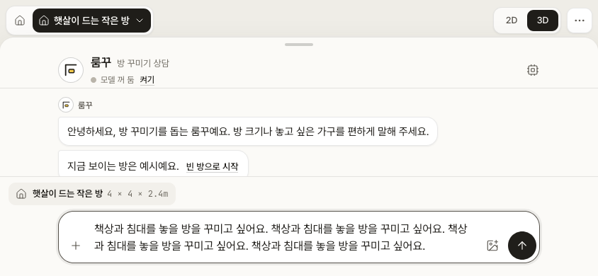
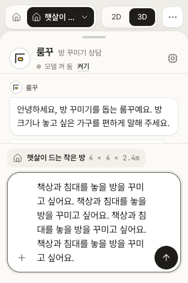

화면이 좁아지거나 입력·첨부 순서가 엇갈릴 때 생기던 문제를 고쳤다. 브라우저 테스트 55개와 단위 테스트 16개를 추가했다.

[룸꾸 열기](https://jinusong.github.io/room-ggu/) · [이전 사진 검증](https://jinusong.github.io/room-ggu/review/photo/)

## A 발견한 문제와 바뀐 동작

| 상황 | 확인한 문제 | 수정 결과 |
|---|---|---|
| 한글 조합 | 229 코드의 Enter로 대화 2턴 생성, 글 지워짐 | 조합을 마치는 Enter는 전송하지 않음 |
| 가로 화면 | 844×390에서 전송 버튼 아래가 402px로 화면 밖 | 입력·전송을 화면 안에 유지 |
| 화면 회전·긴 글 | 폭이 줄어도 입력창 높이가 68px로 고정 | 새 줄 수와 남은 높이로 다시 계산 |
| 메뉴·키보드 | 방향키 이동과 닫은 뒤 초점 복귀 부족 | 방향키·Home/End·Tab·Esc 지원 |
| 시트·폭 드래그 | 취소했는데 시트 단계가 바뀌거나 조절 커서가 남음 | 취소 시 원래 상태, 보이는 높이 안에서 드래그 |
| 대화 폭 안내 | 실제 504px인데 보조 기술에는 920px로 안내 | 실제 폭과 최솟값·최댓값을 함께 갱신 |
| 파일 연속 선택 | 먼저 고른 느린 파일이 나중 파일을 덮음 | 마지막 선택만 반영, 진행·취소·오류 안내 |
| 파일과 이전 작업 | 불러온 방에 이전 침대 초안이 남음 | 상담·사진 작업 종료, 미배치 초안과 미리보기 정리 |
| 새 대화 확인 | Esc·취소 경로 부족, WebKit에서 삭제 클릭이 취소됨 | 취소에 먼저 초점, 바깥 클릭·Esc로 닫기, 삭제 후 입력창 복귀 |
| GPU 미지원 | 지원 불가 판정 직후 모델 카드 초점이 사라짐 | 카드 초점과 설명 읽기는 유지, 실행은 차단 |
| 숫자·알림·동의 | 빈 숫자 처리와 오류 연결, 알림 닫기·배경 조작 보완 필요 | 빈 값 복원, 오류 연결, 알림 닫기, 동의창 배경 조작 차단 |

{table filter}

## B 어떤 경우까지 확인했나

| 영역 | 추가한 상황 |
|---|---|
| 입력 | 한글 조합·229 코드, Shift+Enter, 1,500자, 빈 숫자·범위 밖 숫자·소수 |
| 키보드 | 메뉴 처음·끝·순환 이동, Tab·Shift+Tab, 즉시 Esc, 초점 복귀, 알림 유지·닫기 |
| 화면 | 390×844, 844×390, 320×480, 768×420, 긴 이름·긴 설명, 화면 회전 |
| 작은 보이는 영역 | 390×300, 사진 오류와 입력·전송 동시 표시, 시트 드래그 높이 제한 |
| 파일 | 느린 A와 빠른 B, 이전 오류의 지연, 새 파일 실패, 취소·새 대화, 직접 편집 보호 |
| 복구 | v1~v5 파일, 손상·빈 파일·5MB 초과, 실행 취소, 저장 용량 부족, WebGL 미지원 |
| 사진·상담 동시 작업 | 파일 적용 뒤의 늦은 사진 판별·상담 응답, 기존 사진 45개 흐름 재검사 |
| 접근성 | 숫자 오류 연결, 다운로드 동의창 초점·배경 차단, 동작 줄이기 설정 |

가상 키보드는 보이는 영역을 줄여 재현했다. 실제 휴대폰의 키보드를 사용한 검사는 아니다.

## C 파일을 불러올 때 지키는 순서

```flow
(파일 선택) -> 읽기·취소 안내
읽기·취소 안내 -> {마지막 선택인가?}
{마지막 선택인가?} -> (이전 결과 무시): 아니요
{마지막 선택인가?} -> {읽는 동안 배치를 고쳤나?}: 예
{읽는 동안 배치를 고쳤나?} -> (편집한 배치 유지·다시 불러오기 안내): 예
{읽는 동안 배치를 고쳤나?} -> 파일 적용: 아니요, 유효한 파일
파일 적용 -> 이전 상담·사진 작업 종료
이전 상담·사진 작업 종료 -> 초안·사진·미리보기 정리
초안·사진·미리보기 정리 -> (새 배치·실행 취소 가능)
```

파일 오류나 취소는 현재 배치를 바꾸지 않는다. 보기·격자만 바꾸는 동작은 직접 편집으로 취급하지 않는다.

## D 작은 화면의 실제 모습

844×390 가로 화면에서도 긴 글을 쓰고 전송 버튼을 누를 수 있다.



320×480에서는 글 영역을 스크롤하며 사진 첨부와 전송을 함께 쓴다.



## E 검증 결과

| 검사 | 결과 | 범위 |
|---|---|---|
| 단위 테스트 | 272개 통과 | 기존 256개 + 조합·숫자 경계 16개 |
| Chrome | 194개 통과 | 전체 회귀, 기존 139개 + 새 UI·파일 55개 |
| Firefox | 100개 통과 | 새 55개 + 기존 사진 45개 |
| WebKit | 100개 통과 | 같은 입력·파일·사진 흐름 |
| 실제 SigLIP | 통과 | 침대 사진과 설명 → 침대 초안 150×210×55cm |
| 실제 Gemma 3 1B | 통과 | 정상 상담, 상담 중 파일 적용·이전 결과 무시 |

브라우저의 비동기 실패 테스트는 Worker 응답과 파일 읽기 시점을 제어했다. 대부분의 새 입력·파일 검사는 WebGL을 끄고 2D 복구 경로를 썼다. 긴 글·회전 검사는 실제 3D 경로를 포함하며 Chrome 전체 회귀에서도 기존 2D·3D 기능을 검사했다.

실제 모델은 Mac Chrome WebGPU에서 따로 실행했다. 페이지 오류는 0건이었다. 사진 모델·전처리·판별 기준을 바꾸지 않아 이번에는 사진 58장 정확도 평가를 반복하지 않았다. 이전 정확도 결과는 사진 보고서에 남겼다.

WebKit 첫 실행에서 새 대화 삭제 클릭 실패 1건을 발견해 수정했다. 첫 Pages 검사는 기존 모델 선택 1건이 재시도에서 통과했다. GPU 미지원 응답이 늦게 오면 초점이 빠지는 문제를 찾아 고쳤고 같은 상황을 재현하는 검사도 추가했다.

## F 남은 확인과 근거

```callout warn 실기기 확인 범위
실제 iPhone·Android의 카메라·가상 키보드·OS 클립보드와 Windows GPU는 확인하지 못했다. WebKit 검사는 Safari 실기기 검증과 구별한다. Gemma 4와 각 모델의 f32 경로도 이번에 다시 실행하지 않았다.
```

사진만으로 실제 cm를 재지 않는다. HEIC 전용 디코더와 자동 판별 대상은 추가하지 않았다.

[검증 기록](https://github.com/jinusong/room-ggu/blob/main/docs/verification.md) · [실제 모델 실행 결과](https://github.com/jinusong/room-ggu/blob/main/eval/ui/results/review-20261118-models.json) · [수정 전 관찰값](https://github.com/jinusong/room-ggu/blob/main/eval/ui/results/review-20261118-baseline.json) · [입력 테스트](https://github.com/jinusong/room-ggu/blob/main/tests/ux-input.spec.js) · [파일 테스트](https://github.com/jinusong/room-ggu/blob/main/tests/ux-files.spec.js)
